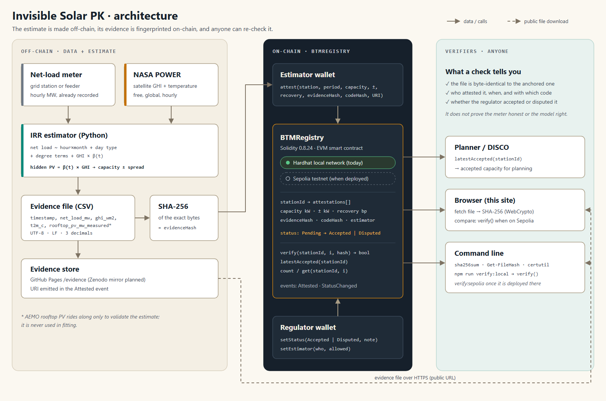
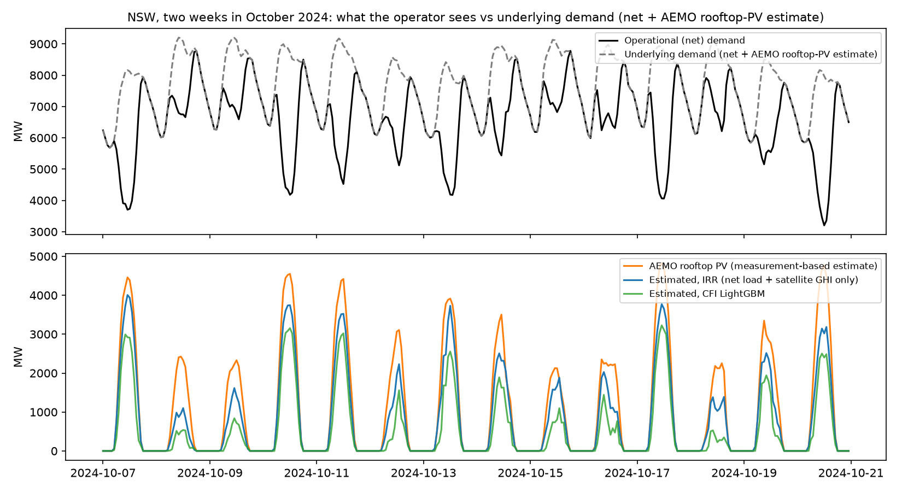
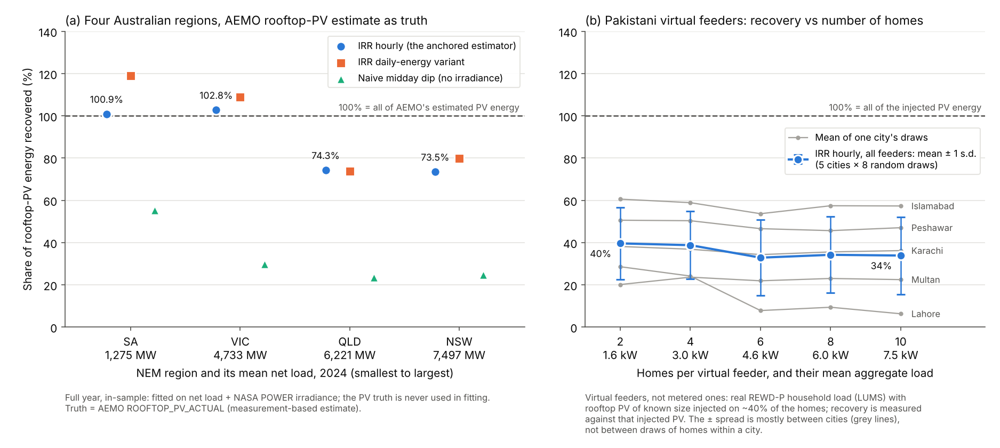
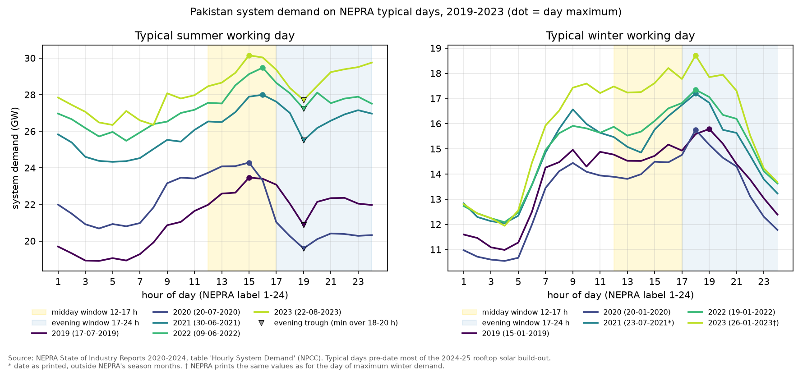

# Invisible Solar PK

**Estimate the rooftop solar a utility cannot see, using only its own net-load meter and free satellite irradiance, and anchor every estimate with a fingerprint of its evidence so a regulator, or anyone else, can check it.**

[](https://github.com/Adan-Khalid/invisible-solar-pk/actions/workflows/ci.yml)
[](LICENSE)
[](chain/contracts/BTMRegistry.sol)
[](requirements-lock.txt)

**[Live demo site](https://adan-khalid.github.io/invisible-solar-pk/)** · [Security note](docs/SECURITY.md) · [Deploy guide](docs/DEPLOY.md)

Adan Khalid, NUST College of Electrical & Mechanical Engineering, Pakistan. Built for the IEEE ClimateChain Global Hackathon 2026.

Status: research prototype, release 0.2.0 (24 Oct 2026), not peer reviewed. The estimator is validated on Australian data, against the rooftop-PV series that the market operator (AEMO) publishes. Every on-chain result in this repository comes from a **local Hardhat network**; nothing is deployed on a public network yet ([DEPLOY.md](docs/DEPLOY.md) explains how).

## The problem

Pakistan's solar boom happened largely behind the meter. Distribution companies (DISCOs) and the system operator see only *net* load: what homes consume minus what their own panels produce. The panels themselves are not in the data.

- A 2026 study by HeraldX and Renewables First mapped solar panels at one Lahore grid station (LESCO's 132 kV Old Defence) from satellite imagery with an AI model. It estimated **177 MW** installed, against an indicative registered figure of **95 MW** shared by LESCO. The study also cites independent estimates of about **38 GW** of distributed solar nationally, against an official figure of about 20 GW ([*The uncounted solar gigawatts*](https://uploads.renewablesfirst.org/The%20uncounted%20solar%20gigawatts%20-%20Distributed%20solar%20mapping%20and%20grid%20impact%20analysis%20in%20Pakistan.pdf)).
- Ember's monthly data, which include Ember's own estimate of distributed solar, put solar at **22.5%** of Pakistan's electricity generation in 2025, up from 8.1% in 2023 (sums of the monthly series, [`m3_ember_pk_annual.csv`](results/tables/m3_ember_pk_annual.csv)).

When the hidden capacity is unknown, day-ahead load forecasts, network-loading studies and expansion plans all start from the wrong number. A capacity figure that someone simply asserts is also hard for a regulator to trust or audit.

**Target users.** DISCO and system planners who need a capacity figure per grid station; the regulator, who needs to audit it; researchers who want to re-run it. **Adoption cost.** No new hardware: the inputs are the hourly net load a utility already records and NASA POWER irradiance, which is free and global.

## What it does



1. **Estimate (Python).** Irradiance-Residual Regression (IRR) explains hourly net load with hour-by-month fixed effects, day type, heating and cooling degree terms, and satellite irradiance (GHI) multiplied by a smooth seasonal coefficient β(t), an annual Fourier series of order 2. Hidden PV is β(t) × GHI, and β × 1000 W/m² is the effective installed capacity. The model never sees a PV series: cloudy versus sunny hours within the same hour and month identify it.
2. **Anchor (Solidity).** The inputs behind each estimate are written to a canonical evidence CSV, and the estimate is computed from that file. The `BTMRegistry` contract stores the estimate together with the file's SHA-256 and a hash of the estimator source code. An authorised estimator submits; a separate regulator accepts or disputes.
3. **Verify (anyone).** Download the published file, hash it (browser, `sha256sum` or `Get-FileHash`) and call `verify()`. Or re-run the estimator on the file and reproduce the anchored integers exactly (`python chain/verify_estimate.py`).

The evidence store today is this repository and its GitHub Pages copy. A long-term mirror such as Zenodo is planned but does not exist yet.

## Try it in about 5 minutes

Needs Node.js 20, 22 or 24 (the versions Hardhat 2.29 supports), Python 3.11 and Git. Most of the time goes into `npm ci`, which downloads about 600 packages and can take a few minutes; `npm test` and `npm run demo` then take under a minute each.

```bash
git clone https://github.com/Adan-Khalid/invisible-solar-pk.git
cd invisible-solar-pk

npm ci                 # exact versions from package-lock.json
npm test               # 57 passing: 37 contract unit tests + 20 on the real evidence files
npm run demo           # narrated end-to-end run on an in-process Hardhat network: 18/18 checks
npm run test:web       # the website's hashing code (docs/assets/verify.js) on the real files
node --test chain/scripts/lib.test.js   # 42 passing: the checks the deploy, anchor and demo scripts run before sending anything
```

`npm run demo` deploys the registry, anchors the four AEMO regions, verifies them as an auditor, shows that +1 MW on a single hourly reading is caught, and walks through a disputed submission. Along the way it refuses a regulator that tries to make itself an estimator, a stranger that tries to attest, and an estimator that tries to accept its own record. It rewrites `results/tables/chain_demo_log.txt`, `chain/deployments/hardhat-demo.json` and, unless a Sepolia record is published, `docs/data/deployment.json` and `results/tables/chain_attestations.csv`. On Windows PowerShell, if `npm` is blocked with "running scripts is disabled", type `npm.cmd` instead or use Command Prompt or Git Bash.

Python side, from the repository root:

```bash
python -m venv venv
source venv/bin/activate              # Windows PowerShell: .\venv\Scripts\Activate.ps1   (cmd: venv\Scripts\activate.bat)
pip install -r requirements-lock.txt  # exact tested versions, pytest included
python -m pytest -q                   # 104 passed + 1 known xfail; without the raw downloads 100 pass and 4 skip
python chain/verify_estimate.py       # re-fits all four evidence files: "4/4 bundles reproduce their anchored numbers"
```

Check an evidence file with no project code at all. The result must equal `evidence_sha256` in [`chain/evidence/manifest.json`](chain/evidence/manifest.json), for NSW `bea275a6aab76cd0bb55282308737b8afa7bfab4c5a6f1db9c995c2fd7c18b30`:

```bash
sha256sum chain/evidence/AEMO_NSW1_2024.csv                                      # Linux, Git Bash
```

```powershell
(Get-FileHash chain\evidence\AEMO_NSW1_2024.csv -Algorithm SHA256).Hash.ToLower()  # Windows PowerShell
```

Optional: the same flow against a local JSON-RPC node, then the auditor script.

```bash
npm run node             # terminal 1: Hardhat node at http://127.0.0.1:8545 (leave it running)
npm run deploy:local     # terminal 2: deploy; writes chain/deployments/localhost.json (git-ignored; the node forgets it when stopped)
npm run anchor:local     # attest the four files, regulator accepts those within the demo rule
npm run verify:local     # auditor check of the NSW file against the chain: MATCH
npx cross-env STATION=AEMO/QLD1 npm run verify:local   # another region
```

`STATION` picks the region (default `AEMO/NSW1`); `FILE`, `INDEX` and `CONTRACT` are optional and described at the top of [`verify-evidence.js`](chain/scripts/verify-evidence.js).

To preview the website locally: `python -m http.server 8000 --directory docs`, then open http://localhost:8000. It needs a web server rather than `file://`, because the page fetches its data files.

## How verification works

**The evidence file.** One CSV per station and period, for example [`chain/evidence/AEMO_NSW1_2024.csv`](chain/evidence/AEMO_NSW1_2024.csv), with a byte-identical copy in `docs/evidence/`:

```
timestamp,net_load_mw,ghi_wm2,t2m_c,rooftop_pv_mw_measured
2024-01-01T00:00,6435.983,0.000,20.980,0.000
```

Timestamps are hour-beginning on NEM market time (AEST, UTC+10) for all four regions. Values are fixed to 3 decimals, and the files are UTF-8 with LF line endings and no BOM (`src/invisible_solar/evidence.py`). The estimator fits on `net_load_mw`, `ghi_wm2`, `t2m_c` and the calendar. `rooftop_pv_mw_measured` is AEMO's rooftop-PV series and is carried only to validate the estimate. Its name follows AEMO's type label `MEASUREMENT`; the values are AEMO's measurement-based estimate, not metered output of every system.

**Two hashes.**
- `evidenceHash` is the plain SHA-256 of the file bytes. Adding 1 MW to one reading, converting the file to CRLF line endings or removing its last byte each changes it, and the tests check all three cases; re-saving the file from a spreadsheet program would change it too. `.gitattributes` keeps git from rewriting the files on Windows.
- `codeHash` is SHA-256 over the four modules on the evidence-to-estimate path (`evidence.py`, `features.py`, `hidden_pv.py`, `metrics.py`, CRLF normalised to LF). CI recomputes it with `hashlib` alone. Library versions are not covered; `requirements-lock.txt` pins them. (`manifest.json` also records `code_version` 0.1.0, the Python package's version string when the bundles were exported; `code_hash` is what pins the code.)

**What one attestation stores.** Each record is filed under a `stationId` (`keccak256` of the name, for example `"AEMO/NSW1"`) and holds the period, `capacityKwEff`, `uncertaintyKw`, `energyRecoveryBp`, both hashes, the status, the estimator address and the block time. The download link `evidenceURI` is emitted in the `Attested` event.
- `uncertaintyKw` is the **seasonal spread** of the 12 monthly capacity estimates, **not a confidence interval**. `capacityKwEff` is their mean.
- `energyRecoveryBp` is the energy recovery against an independent PV reference; the contract leaves it to the manifest to say whether that check is in-sample. For the four AEMO records it is the **in-sample** recovery against AEMO's rooftop-PV series (`validation.kind` in `manifest.json`).

**Roles.** The deployer is the regulator. It authorises estimators and accepts or disputes their records. No account can hold both roles at once: the regulator cannot be made an estimator, and an estimator cannot be handed the regulator role (`RegulatorCannotEstimate`). An estimator can only `attest`; it cannot change a status (`NotRegulator`). Anyone can read `get`, `count`, `latestAccepted` and `verify`. Handing over the regulator role takes two steps (`transferRegulator`, then `acceptRegulator` from the new address). In production the regulator should be a multisig. The separation is checked per address at one point in time: an address whose estimator role was revoked and that later became regulator could accept its own earlier records, so the regulator role must not go to a former estimator ([SECURITY.md](docs/SECURITY.md), section 4).

**Lifecycle.**

```
attest -> Pending --setStatus--> Accepted <--setStatus--> Disputed
                  \--setStatus--> Disputed
```

Estimates are never edited or deleted; only the status changes, and each change emits `StatusChanged` with a note. A correction is a new attestation with a new index. Planners read `latestAccepted(stationId)`. In the demo and in `anchor.js`, the regulator accepts automatically when the in-sample recovery lies within 70-130 %. That is a demonstration rule, not a regulatory standard.

**What the chain proves, and what it does not.** It proves that a specific file and a specific version of the estimator code were committed by a specific estimator address at a specific time, and whether the regulator then accepted or disputed the record. It does **not** prove that the meter readings in the file were honest (a hash of false data is still a valid hash), that the estimate is right, or that the estimator really ran the code it declared. Those are checked off-chain: the data are public, `verify_estimate.py` re-estimates from the file, and the regulator reviews. [SECURITY.md](docs/SECURITY.md) has the full threat model and the known governance limits.

**Gas, local Hardhat network** (solc 0.8.24, optimizer 200 runs; [`chain_gas_report.txt`](results/tables/chain_gas_report.txt), `npm run test:gas`): deployment 986,475; `attest` 125,946-143,664 (average 138,063); `setStatus` average 35,518; `setEstimator` average 37,957.

**Tests.** `npm test` runs 57 Hardhat tests and `npm run coverage` reports 100 % statement, branch, function and line coverage of `BTMRegistry.sol`. `node --test chain/scripts/lib.test.js` runs 42 plain-Node unit tests of `chain/scripts/lib.js`, the checks that the deploy, anchor, Remix-argument and demo scripts make before anything is sent. The pytest suite (104 passed and 1 known xfail with the raw downloads) covers every line of `config`, `data`, `evidence`, `features`, `forecast`, `hidden_pv` and `metrics`, and 97 % of `flexibility.py`. `npm run test:web` tests the website's hashing code against the real evidence files. CI ([`ci.yml`](.github/workflows/ci.yml)) runs pytest with the pinned versions, `verify_estimate.py`, the contract tests, the demo and the website tests on Node 20, 22 and 24, and the plain-tool hash checks, on every push and pull request.

## Results

All numbers below are read from `results/tables/` and `chain/evidence/manifest.json`; the scripts that produce them are listed under [Reproduce the science](#reproduce-the-science).

### Four Australian regions with published rooftop PV

AEMO publishes both operational demand (net of rooftop PV) and rooftop PV (`ROOFTOP_PV_ACTUAL`, type `MEASUREMENT`). That makes the Australian National Electricity Market a place where the hidden series can be hidden from the estimator and then compared. AEMO's series is itself a measurement-based estimate (its data model calls the values "estimated generation"), not a census. Year 2024, IRR hourly ([`m1_multiregion_nem.csv`](results/tables/m1_multiregion_nem.csv), [`manifest.json`](chain/evidence/manifest.json)):

| Region | Mean net load (MW) | Rooftop PV share of underlying demand | Energy recovered, full year | Hourly corr., all hours / daylight | Held-out recovery (fit odd months, test even) | Naive midday dip, no irradiance | Anchored capacity ± seasonal spread (MW) |
|---|---:|---:|---:|---:|---:|---:|---:|
| NSW | 7,497 | 11.6% | 73.5% | 0.949 / 0.915 | 66.3% | 24.9% | 4,222 ± 1,372 |
| QLD | 6,221 | 13.2% | 74.3% | 0.965 / 0.940 | 72.6% | 23.5% | 3,593 ± 1,013 |
| VIC | 4,733 | 11.9% | 102.8% | 0.966 / 0.943 | 102.2% | 29.9% | 3,724 ± 972 |
| SA | 1,275 | 22.3% | 100.9% | 0.978 / 0.961 | 99.3% | 55.4% | 1,824 ± 422 |

- **Recovery is 73.5-102.8% of AEMO's rooftop-PV energy.** VIC and SA are within 3% of AEMO's figure; NSW and QLD under-recover by about 26%.
- The full-year figures are **in-sample**: the model is fitted on the same year's net load and irradiance, but the PV series is never used in fitting. The held-out column fits on odd months and predicts even months.
- Satellite irradiance is what makes this work. The naive "midday dip" method, which has no irradiance, recovers only 23.5-55.4%.
- The ± figure is the standard deviation of the 12 monthly capacity estimates, a seasonal spread, **not** a confidence interval.

**NSW, estimator comparison** ([`m1_aemo_nsw_hidden_pv_recovery.csv`](results/tables/m1_aemo_nsw_hidden_pv_recovery.csv)):

| Estimator | Fit / test | Energy recovered | Hourly corr. | Hourly R² |
|---|---|---:|---:|---:|
| IRR hourly (the anchored estimator) | full year, in-sample | 73.5% | 0.949 | 0.83 |
| IRR hourly | fit odd months, test even | 66.3% | 0.916 | 0.73 |
| IRR hourly | fit Jan-Jun, test Jul-Dec | 109.8% | 0.929 | 0.81 |
| IRR daily-energy | full year, in-sample | 79.9% | 0.914 | 0.81 |
| IRR daily-energy | fit odd months, test even | 68.1% | 0.874 | 0.69 |
| CFI (LightGBM, GHI set to zero) | full year, in-sample | 51.8% | 0.943 | 0.64 |
| CFI (LightGBM, GHI set to zero) | fit odd months, test even | 45.3% | 0.941 | 0.54 |
| CFI (LightGBM, GHI set to zero) | fit Jan-Jun, test Jul-Dec | 45.4% | 0.918 | 0.11 |
| Naive midday dip (no irradiance) | full year | 24.9% | 0.716 | 0.14 |

**NSW month by month** ([`m1_aemo_nsw_capacity_by_month.csv`](results/tables/m1_aemo_nsw_capacity_by_month.csv)), against the capacity implied by AEMO's series:
- within 10% in June-September
- 15-28% low in April, May and October
- 34-46% low from November to March

A likely reason: in summer, sunshine is confounded with air-conditioning load. Sunny hours are also hot hours, so the cooling terms can absorb part of the solar signal.



Top: operational (net) demand and underlying demand. Bottom: AEMO's rooftop PV (orange), the IRR estimate (blue) and the CFI LightGBM estimate (green).

### Day-ahead net-load forecasting, NSW

The model is trained on January-September 2024 and tested on October-December, hourly, with lags of at least 24 h. The hidden-PV feature comes from IRR fitted on the training months only ([`m2_forecast_benchmark.csv`](results/tables/m2_forecast_benchmark.csv)):

| Model | MAPE | nRMSE | 80% interval coverage |
|---|---:|---:|---:|
| Seasonal naive (same hour, one week earlier) | 11.6% | 16.8% | - |
| LightGBM, no solar input | 7.7% | 9.9% | 52% |
| LightGBM + satellite GHI | 5.6% | 7.6% | 55% |
| LightGBM + GHI + hidden-PV estimate | 5.5% | 7.9% | 53% |

- **Accuracy.** Free satellite irradiance cuts day-ahead MAPE from 7.7% to 5.6% and nRMSE from 9.9% to 7.6%.
- **The hidden-PV feature adds nothing measurable.** MAPE falls by only 0.04 points (5.56% to 5.52%) and nRMSE gets worse (7.6% to 7.9%). Its value is the capacity number a planner can read, not forecast skill.
- **Intervals.** The q10-q90 intervals are under-dispersed (52-55% coverage at 80% nominal) and would need calibration.
- **Weather inputs.** The weather is the observed values (perfect foresight), so the gains are an upper bound; a real deployment would use weather forecasts.
- **Table date.** The NSW rows were recomputed on 25 Oct 2026 with the current code, after the 24 Oct time-alignment fixes, and `m2_nsw_forecast_week.png` was redrawn. The Pakistani rows were recomputed on 28 Oct 2026 with the current code, after the Karachi clock fix (see below).

### Pakistan: injected PV on real household load

No Pakistani feeder publishes both net load and metered rooftop PV. As a substitute, virtual feeders are built from real household load (REWD-P, LUMS Energy Institute; 10 homes per city in Lahore, Karachi, Islamabad, Multan and Peshawar). Rooftop PV of known size (3-7 kW per home) is added to 20, 40 or 60% of the homes, and the estimator is asked to find it. Mean energy recovery over the five cities, IRR hourly ([`m1_pk_virtual_feeder_recovery.csv`](results/tables/m1_pk_virtual_feeder_recovery.csv)):

| Irradiance used to simulate the injected PV | 20% of homes | 40% | 60% |
|---|---:|---:|---:|
| Ground weather station (independent of the estimator's satellite input) | 27% | 36% | 39% |
| NASA POWER, the estimator's own input (upper bound) | 61% | 79% | 84% |

- **The realistic case is the first row.** There the PV is driven by a different irradiance source from the one the estimator sees.
- **Lahore fails** (0.5-14% across the three penetrations); Islamabad does best (52-60%).
- **No gain from adding homes.** A scale curve over random subsets of 2-10 homes (PV on about 40% of them, driven by ground-station irradiance; 5 cities × 8 draws, [`m1_pk_scale_curve.csv`](results/tables/m1_pk_scale_curve.csv)) gives 33-40% recovery, with no upward trend.
- **The ±16-18 point spread in the figure is mostly between cities.** Mean recovery over all draws: Lahore 15%, Multan 22%, Karachi 36%, Peshawar 48%, Islamabad 58% ([`m1_pk_scale_curve_raw.csv`](results/tables/m1_pk_scale_curve_raw.csv)).
- **Forecasting.** On these 10-home feeders the LightGBM forecasters stay at 34-37% nRMSE. MAPE is meaningless there because net load crosses zero.

**What this means.** At 10 homes, the mismatch between satellite and ground irradiance appears to be the main limit: when the injected PV follows the estimator's own irradiance, recovery rises to 61-84%. The method is meant for grid-station or DISCO scale. The four Australian regions (1.3-7.5 GW mean net load) are larger still, and these data cannot say where between 10 homes and about 1.3 GW it becomes reliable. It should be validated on a real feeder with metered PV before anyone relies on it.

**Karachi clock fix applied.** The Pakistani tables and panel (b) of the figure below were recomputed on 28 Oct 2026 with the 24 Oct fix to the NASA POWER time alignment (Karachi's "LST" is UTC+4, so its series moves +1 h onto PKT; the other four cities are unchanged). Only Karachi's numbers moved, by at most 2 percentage points per case; the five-city averages and ranges quoted above are unchanged at the precision shown.

The same households have sub-metered air-conditioning circuits. In summer (May-September), AC accounts for 26% (Islamabad), 34% (Peshawar), 37% (Lahore), 42% (Karachi) and 54% (Multan) of household load ([`m3_cooling_flexibility_by_city.csv`](results/tables/m3_cooling_flexibility_by_city.csv)).



How to read the figure:
- **Panel (a)** is the full-year, in-sample recovery.
- **Panel (b)** shows the mean ± 1 s.d. over 5 cities × 8 random draws. The spread is mostly between cities, not between draws.

### Pakistan's grid demand shape (NEPRA typical days)

Source: NEPRA State of Industry Reports 2020-2024, table "Hourly System Demand (MW)" (National Power Control Centre). The report of year N carries calendar year N-1, so the data cover 2019-2023. Each year has six profiles: typical summer and winter working and non-working days, and the summer and winter days of maximum demand. Hours are NEPRA's printed labels 1-24. Statements and metric definitions are in [`m3_summary.md`](results/tables/m3_summary.md):

- **Typical summer working days peak in mid-afternoon.** The day maximum was 23.5 GW (2019), 24.3 GW (2020), 28.0 GW (2021), 29.5 GW (2022) and 30.2 GW (2023), always at hour 15 or 16. These days are flat, with a load factor of 0.89-0.94.
- **Summer evenings dip at dusk, then rise again at night.** On all five typical summer working days, demand falls 2.2-4.7 GW from the afternoon maximum to a trough at hour 19, then climbs 0.8-2.0 GW by hour 20-24 without reaching the afternoon peak again. The tables do not show why demand dips at dusk.
- **Correction to release 0.1.0.** Its "evening ramp of 2.4-2.6 GW" was the summer working-day climb from hour 10 to the afternoon peak (2.56 / 2.48 / 2.36 GW in 2021 / 2022 / 2023). Its "2020 summer peak of 21.0 GW" was the hour-17 value of a day that peaks at 24.3 GW at hour 15.
- **Winter has a real evening peak.** On every typical winter working day the day's peak falls at hour 18-19 (15.8-18.7 GW). From the midday minimum at hour 13-14, demand rises 1.3-1.9 GW in 2019, 2020, 2022 and 2023 (254-390 MW/h). The 2021 profile, which NEPRA prints with a July date (23-07-2021), rises 2.3 GW.
- **The steepest working-day ramps are winter mornings:** 3.2-4.0 GW in three hours, starting at hour 4-5. Typical summer working days reach 1.5-2.5 GW.
- **Storage on the 2023 typical summer working day** (22-08-2023, maximum 30,150 MW at hour 15), for a battery that repeats the same day:
  - **95% cap (28.6 GW).** 1.51 GW of battery power. Demand is above the cap for 9 hours in two blocks (hours 13-17 and 21-24), a daily discharge of 7.5 GWh. Because the battery can recharge in hours 18-20, about 6.25 GWh of storage is enough.
  - **90% cap (27.1 GW).** 18 of the 24 hours sit above it, and the 6 hours below cannot refill the battery, so a daily-cycling battery cannot hold this cap.
  - **Lowest holdable cap.** 93.8% of the maximum.
- **Across 2019-2023,** a 90% cap is within-day feasible on only 1 of 15 summer profiles, and a 95% cap on 13 of 15. All 15 winter profiles are feasible at both caps. The lowest holdable cap is 82.4-88.9% of the day maximum in winter and 89.8-96.3% in summer.
- **Ember's solar share already counts rooftop.** Ember estimates distributed solar itself and includes it (Ember methodology v1.6, Pakistan section): 8.1% (2023), 13.9% (2024), 22.5% (2025), with a monthly maximum of 34.6% (Feb 2026). This dataset does not publish the distributed component separately.

**Scope.** These are six representative days per year from 2019-2023, before most of the 2024-25 rooftop build-out, so they cannot show any change rooftop solar has made to the daily shape since. The storage figures describe one repeated day; they are not a dispatch study.



## Limitations

- **Validation is Australian.** The estimator is validated only where AEMO publishes rooftop PV (four NEM regions). The headline recovery is in-sample; the held-out split (odd/even months) is shown alongside it. NSW and QLD under-recover by about a quarter, and in NSW the shortfall is concentrated in summer.
- **The reference series is itself an estimate.** AEMO's `ROOFTOP_PV_ACTUAL` `MEASUREMENT` is a measurement-based estimate, not a census.
- **The capacity "±" is a seasonal spread,** not a confidence interval. No formal uncertainty quantification is done yet.
- **Pakistan has no reference series.** The Pakistani test uses injected PV on 10-home virtual feeders, far below the scale the method targets. Lahore fails. The REWD-P "Generation" columns are empty in this release.
- **Time alignment.** NASA POWER hourly "LST" stamps are UTC plus the whole-hour offset of the 15° longitude band. The loaders shift Adelaide and Karachi by +1 h and leave the other cities unchanged. AEMO interval-ending stamps are averaged into hour-beginning hours.
- **Forecasting** assumes perfect-foresight weather, so its gains are an upper bound, and its quantile intervals are under-dispersed. Its NSW and Pakistani rows both use the current code.
- **NEPRA.** The typical days come from tables parsed from PDF reports. NEPRA does not say whether its hour labels are hour-ending, whether K-Electric's system is included, or how load-shedding is treated. Two source-table entries look odd: one winter profile carries a July date, and one is the same column as the day of maximum demand (noted in `m3_summary.md`).
- **The chain.** Everything ran on a local Hardhat network; nothing is on a public network yet.
  - A hash does not make data honest (the oracle problem).
  - One regulator address decides status; a multisig would reduce, not remove, that trust.
  - `codeHash` is declared by the estimator, not enforced by the contract; re-estimation catches a mismatch.
  - See [SECURITY.md](docs/SECURITY.md).

## Reproduce the science

The four evidence files in `chain/evidence/` are enough to reproduce the anchored estimates (`python chain/verify_estimate.py`). To rebuild every table and figure from raw data:

1. Download the raw inputs listed in [`data/README.md`](data/README.md). They go to `./data` by default (git-ignored); set `INVISIBLE_SOLAR_DATA` to use another folder.
2. Run the scripts below **from the repository root**, because they add `src` to the path relative to the working directory.

Which inputs each step needs:
- **NEPRA parsing** needs `pdftotext` (poppler-utils on Linux, `brew install poppler` on macOS; Git for Windows ships it and the parser finds it automatically).
- **Scripts 03, 04 and 06 need REWD-P.** 04 writes its table only after its Pakistani part, and 07 skips its Pakistani part when REWD-P is absent.

**Windows (PowerShell + Git Bash)**

```powershell
python -m venv venv
.\venv\Scripts\Activate.ps1
pip install -r requirements-lock.txt
# optional, otherwise .\data is used:  $env:INVISIBLE_SOLAR_DATA = "D:\invisible-solar-data"
```

Run the download in **Git Bash** from the repository root (it needs bash, curl and unzip, which Git for Windows provides): `bash scripts/00_download_data.sh`. If you set a custom folder, export the same folder there first, for example `export INVISIBLE_SOLAR_DATA=/d/invisible-solar-data`. Then, back in PowerShell:

```powershell
python scripts/01_prepare_data.py              # AEMO rooftop zips -> hourly; REWD-P 1-min -> hourly
python scripts/parse_nepra_soi.py              # optional: 05 runs it when the NEPRA PDFs are present
python scripts/02_hidden_pv_aemo.py            # NSW estimator comparison, monthly capacity, NSW figures
python scripts/03_hidden_pv_pakistan_feeder.py # Pakistani virtual feeders (REWD-P)
python scripts/04_forecast_benchmark.py        # day-ahead forecasting (NSW + REWD-P feeders)
python scripts/05_nepra_ramp_atlas.py          # NEPRA typical days, storage, Ember
python scripts/06_cooling_flexibility.py       # AC share and temperature sensitivity (REWD-P)
python scripts/07_multiregion_and_scale.py     # four NEM regions + Pakistani scale curve + figure
python chain/export_evidence.py                # rebuild the evidence files, manifest.json, docs/data/site.json
python chain/verify_estimate.py
```

**Linux / macOS (bash)**

```bash
python3.11 -m venv venv && source venv/bin/activate
pip install -r requirements-lock.txt
# export INVISIBLE_SOLAR_DATA=/path/to/data   # optional, default ./data
bash scripts/00_download_data.sh
python scripts/01_prepare_data.py
python scripts/02_hidden_pv_aemo.py
python scripts/03_hidden_pv_pakistan_feeder.py
python scripts/04_forecast_benchmark.py
python scripts/05_nepra_ramp_atlas.py           # runs scripts/parse_nepra_soi.py first
python scripts/06_cooling_flexibility.py
python scripts/07_multiregion_and_scale.py
python chain/export_evidence.py
python chain/verify_estimate.py
```

`chain/export_evidence.py` rewrites the anchored evidence files. With the pinned versions and the same raw downloads it reproduces them byte for byte. The `rawdata` tests check this (`python -m pytest -m rawdata` with `INVISIBLE_SOLAR_DATA` set), and afterwards `git status chain/evidence docs/evidence` should show no change. If a hash ever changes, the on-chain records no longer match the files; do not commit changed bundles without re-anchoring. `scripts/plot_scale_and_regions.py` redraws `m1_scale_and_regions.png` from the two committed tables without any raw data. Multi-threaded BLAS only slows these small regressions down, so the analysis scripts, the tests and `verify_estimate.py` default to one BLAS thread; export `OPENBLAS_NUM_THREADS` or `MKL_NUM_THREADS` to override.

To deploy the registry to the Sepolia testnet, with the Hardhat or the Remix path, follow [docs/DEPLOY.md](docs/DEPLOY.md).

## Repository map

| Path | Contents |
|---|---|
| [`src/invisible_solar/`](src/invisible_solar/) | Python package. `hidden_pv.py` (IRR, IRR-daily and CFI estimators), `features.py`, `metrics.py` and `evidence.py` (canonical evidence CSV and hashing) are the four modules covered by the anchored `codeHash`; `data.py` (loaders), `forecast.py`, `flexibility.py`, `config.py` |
| [`scripts/`](scripts/) | Pipeline `00`-`07`, `parse_nepra_soi.py`, `plot_scale_and_regions.py` |
| [`chain/contracts/BTMRegistry.sol`](chain/contracts/BTMRegistry.sol) | The registry contract (Solidity 0.8.24) |
| [`chain/test/`](chain/test/) | 57 Hardhat tests: contract unit tests and tests on the real evidence files |
| [`chain/scripts/`](chain/scripts/) | `demo.js` (narrated end-to-end run), `deploy.js`, `anchor.js`, `verify-evidence.js` (auditor check), `remix-args.js` (arguments for the Remix path), `lib.js` |
| [`chain/evidence/`](chain/evidence/) | The four AEMO 2024 evidence files and `manifest.json` (hashes, anchored values, validation) |
| [`chain/deployments/`](chain/deployments/) | Deployment records: `hardhat-demo.json` (ephemeral demo) and `remix-args.json` (inputs for the Remix path); `sepolia.json` appears after a testnet deployment |
| [`chain/export_evidence.py`](chain/export_evidence.py), [`chain/verify_estimate.py`](chain/verify_estimate.py) | Build the evidence files from raw data; re-derive the anchored numbers from the files alone |
| [`docs/`](docs/) | GitHub Pages site (`index.html`, `assets/`, `data/`, `evidence/`), [`SECURITY.md`](docs/SECURITY.md), [`DEPLOY.md`](docs/DEPLOY.md), `architecture.svg`/`.png`, [`literature_map.md`](docs/literature_map.md) |
| [`results/tables/`](results/tables/), [`results/figures/`](results/figures/) | Every number and figure quoted here, including the chain demo log and gas report |
| [`tests/`](tests/), `pytest.ini` | Python test suite |
| [`.github/workflows/ci.yml`](.github/workflows/ci.yml) | CI: pytest and re-estimation, Hardhat tests, demo and website tests, plain-tool hash checks |
| [`data/README.md`](data/README.md) | Raw-data sources and layout (the data themselves are not committed) |
| `package.json`, `hardhat.config.js`, `.env.example` | Node/Hardhat project; `.env` (git-ignored) is needed only for Sepolia |
| `requirements.txt`, `requirements-dev.txt`, `requirements-lock.txt` | Python dependencies; the lock file holds the exact tested versions |

## Data credits and licences

| Source | Used for | Terms |
|---|---|---|
| AEMO: NEM price and demand (5-min operational demand); MMSDM `ROOFTOP_PV_ACTUAL` | Net load and the rooftop-PV reference series for NSW, QLD, VIC, SA | AEMO copyright; see AEMO's copyright permissions |
| NASA POWER hourly (CERES SYN1deg irradiance, MERRA-2 temperature) | The estimator's irradiance and temperature inputs | Free; data from NASA Langley Research Center's POWER project, funded by the NASA Earth Science Division ([how to reference](https://power.larc.nasa.gov/docs/referencing/)) |
| REWD-P, Residential Energy and Weather Data Pakistan (LUMS Energy Institute) | Pakistani household load, AC sub-meters, ground weather stations | Published as open data by the LUMS Energy Institute; the dataset page names no licence |
| NEPRA State of Industry Reports 2020-2024 | Typical-day hourly system demand | Government publication |
| Ember monthly electricity data | Pakistan solar share and demand | CC BY 4.0 |

Download links and the expected file layout are in [`data/README.md`](data/README.md). The four evidence files in `chain/evidence/` and `docs/evidence/` are derived from AEMO and NASA POWER data. Problem framing: HeraldX and Renewables First, *The uncounted solar gigawatts* (2026); further reading, with each entry checked, in [`docs/literature_map.md`](docs/literature_map.md).

Code: MIT licence ([LICENSE](LICENSE)).

## How this was built

This project was built with AI assistance. Most of the code (Python package, analysis scripts, smart contract, Hardhat scripts and tests, website) and most of the documentation, this README included, were written by AI coding agents (Claude, by Anthropic, through Claude Code) working under the author's direction. The author is responsible for every claim. Every result in this README is read from a file in `results/tables/` or `chain/evidence/` that the scripts in this repository produce.

## Citation

Please cite the software through [`CITATION.cff`](CITATION.cff) (GitHub's "Cite this repository" button), for example:

```
Khalid, A. (2026). Invisible Solar PK: estimating hidden rooftop PV from net load and satellite
irradiance, with on-chain evidence anchoring (Version 0.2.0) [Computer software].
https://github.com/Adan-Khalid/invisible-solar-pk
```
